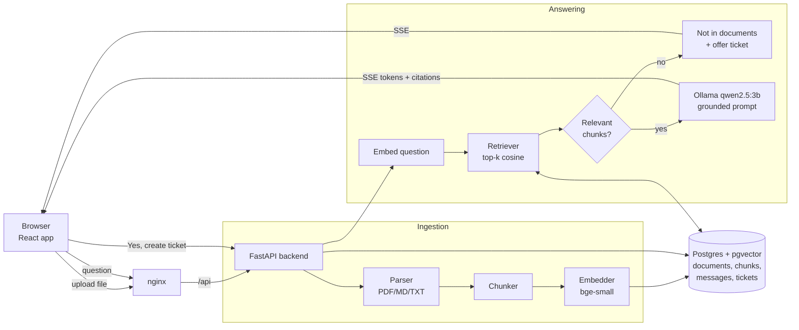

# Architecture — Ask Onboarding

> Keep this to 1–3 pages. Fill in each _TODO_ once the decision has been tested.

## Diagram

## 1. How it works today

The path of one question, step by step: _TODO_ (browser → nginx → `/api/chat` → embed → pgvector search → threshold check → prompt → Ollama stream → SSE → UI renders citations).

## 2. Our choices

| Decision | Choice | Why / what was tried |
|---|---|---|
| Chunk size / overlap | 800 / 120 chars | Same 100% retrieval hit rate as 400/60 on the eval set (documents are short); 800 keeps whole policies together |
| Embedding model | bge-small-en-v1.5 (local) | _TODO_ |
| Vector store | pgvector | One database; transactional replace-on-reupload |
| top-k | 5 | top-k 3 was 2× faster but answer accuracy fell from 82% to 65% (see README) |
| No-answer detection | similarity cutoff 0.50 + prompt rule | Two layers, because a cutoff alone can't do it (see below) |
| LLM | qwen2.5:3b via Ollama | Free and local (training project, no API budget). 3B is the largest that answers at a usable speed on a CPU-only laptop with 8 GB for Docker. See the first live test below. |

**Choosing the no-answer cutoff.** I scored 16 questions against 6 short policy documents (bge-small, best-chunk cosine similarity):

| Question type | Score range | Examples |
|---|---|---|
| Answerable | 0.65 – 0.85 | "How many vacation days do I get?" 0.71, "What do I do if my laptop is stolen?" 0.85 |
| General knowledge | ~0.37 | "What is the capital of France?" 0.37 |
| Sounds like company policy, not covered | 0.49 – 0.62 | "Parental leave policy?" 0.62, "Wifi password?" 0.59, "Dress code?" 0.49 |

The third group overlaps the first ("parental leave" 0.62 vs "carry over unused leave" 0.65), so no single cutoff separates them. The cutoff (0.50) therefore only removes clearly off-topic questions, which get an instant "not in the documents" without an LLM call. Near-misses reach the LLM, and the prompt makes it say when the sources don't cover the question. I chose 0.50 rather than 0.55 because real chunks are longer than these test passages, and longer chunks score lower. On the 20-question eval set this gives 100% correct no-answers with no answerable question blocked by the cutoff.

**First live test of the LLM** (qwen2.5:3b, CPU only, i7-1355U, 6 short documents):

| Question | Result | Time |
|---|---|---|
| What should I do if my laptop is stolen? | Correct and complete; cited only the right source | 49 s (includes loading the model) |
| Can I use Jira from home, and how many vacation days do I get? | Combined two documents; cited both correctly | 13 s to first token, 21 s total |
| What is the company's parental leave policy? | Model replied NOT_FOUND from 4 related sources → no-answer + ticket offer | 9 s |
| What is the capital of France? | Below the cutoff → no-answer without an LLM call | 0.1 s |

Most of the wait is the CPU reading the prompt (5 sources × up to 800 characters) before the first token. Lowering TOP_K or using a GPU would cut it; with a hosted LLM API it would be about 1 s.

What didn't work: the original default cutoff of 0.35 let every question through, because bge-small scores even unrelated text around 0.35–0.6.

## 3. Scaling up (5,000 employees, 200k docs, 20k questions/day)

- **Ingestion:** _TODO_ (job queue, incremental sync by hash/modified time, batched embeddings)
- **Storage:** _TODO_ (vector count, HNSW memory, partitioning, or a dedicated vector DB)
- **Latency:** _TODO_ (caching, smaller models, streaming)
- **Cost:** _TODO_ (tokens per question × 20k/day, prompt caching)

## 4. Failure modes (LLM provider down for 30 minutes)

_TODO: what the user sees (clear error, retrieved sources still shown), retries/backoff, recovery._

## 5. Quality: catching regressions before release

_TODO: run the eval set in CI, compare against a baseline, LLM-as-judge plus a human spot check._

## 6. RAG vs. fine-tuning

_TODO_
